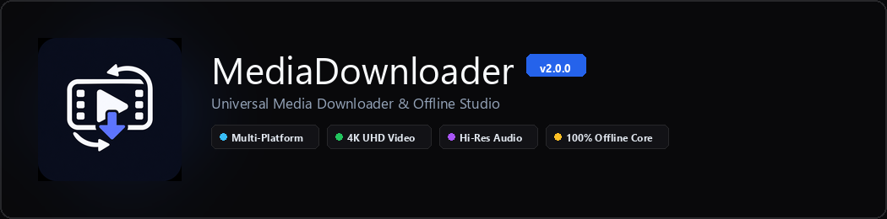

<div align="center">



# 📥 MediaDownloader
**Universal Media Downloader & Offline Studio untuk Windows**

[](https://github.com/FauzanZuhri/MediaDownloader)
[](https://www.python.org/)
[](https://github.com/TomSchimansky/CustomTkinter)
[](https://github.com/yt-dlp/yt-dlp)
[](LICENSE)

*Aplikasi desktop modern yang elegan, cepat, dan tangguh untuk mengunduh, mengekstrak, dan mengonversi audio maupun video berkualitas tinggi dari berbagai platform global tanpa iklan dan tanpa batasan.*

</div>

---

## 🌟 Sorotan Fitur Utama

### 🌐 1. Dukungan Multi-Platform Universal
- **Bebas Watermark:** Unduh video pendek dari **TikTok** dan **Instagram Reels** dalam kualitas asli tanpa watermark.
- **Platform Musik & Audio Original:** Ekstraksi audio langsung dari **SoundCloud**, **Bandcamp**, **Spotify**, dan **Apple Music** lengkap dengan cover art resmi dan penandaan tag ID3v2.3.
- **Media Sosial & Platform Video Global:** Mendukung **YouTube**, **X (Twitter)**, **Facebook Video**, **Pinterest**, **Bilibili**, dan **Vimeo**.
- **Deteksi Cerdas & Badge:** Aplikasi otomatis mengenali sumber tautan, menampilkan badge platform (`🎵 TIKTOK`, `☁️ SOUNDCLOUD`, `▶️ YOUTUBE`), dan mengadaptasi format terbaik secara otomatis.

### 🎬 2. Video 4K UHD & Audio Berkualitas Studio
- **Video Hingga 4K 60fps:** Unduh video jernih dalam kontainer universal **MP4** dengan pilihan resolusi dari 360p, 720p HD, 1080p FHD, hingga 2160p (4K UHD).
- **High-Bitrate MP3:** Ekstraksi audio hingga 320 kbps dengan integrasi encoder FFmpeg lokal.
- **Normalisasi Suara EBU R128:** Teknologi *loudness matching* otomatis yang menyeimbangkan volume antar lagu agar stabil dan nyaman didengar di earphone atau speaker mobil.
- **Metadata Otomatis & Cover Art:** Setiap lagu otomatis disematkan judul asli, nama artis, album, dan cover art resolusi tinggi via Mutagen, siap diputar di Spotify Local Files, Apple Music, AIMP, atau MusicBee.

### 📋 3. Batch Queue & Pemilih Trek Playlist Interaktif
- **Unduh Massal (Batch Queue):** Masukkan banyak tautan sekaligus (multi-baris atau import file `.txt`) dengan status progres per-item yang rapi.
- **Turbo Multi-Threaded Engine:** Akselerasi pengunduhan potongan fragmen video/audio secara simultan dengan koneksi paralel dan buffer data optimal.
- **Interactive Playlist Hub:** Jendela pemilih trek playlist interaktif yang memungkinkan Anda memilih lagu tertentu, mencari judul lagu, atau membatalkan lagu yang tidak diinginkan sebelum masuk antrean.

### 🗔 4. Otomasi Alur Kerja & Integrasi Sistem Operasi
- **Active Background Clipboard Monitor:** Pantau clipboard Windows secara cerdas. Salin tautan media dari browser, dan MediaDownloader akan langsung memuat metadata serta preview-nya secara instan.
- **Minimize to System Tray:** Berjalan hening dan hemat daya di area notifikasi taskbar Windows saat jendela ditutup, dilengkapi menu klik kanan untuk membuka aplikasi atau folder unduhan secara cepat.
- **Anti-Duplikasi (Download Archive):** Mencegah video atau lagu yang sama terunduh berulang kali secara otomatis.

### 🎨 5. Antarmuka Minimalis Modern (UI/UX 2.0)
- **Desain Zinc Canvas:** Palet warna gelap modern yang nyaman di mata dengan aksen Sapphire Blue.
- **Live Media Preview Card 16:9:** Kartu pratinjau media proporsional yang menampilkan cover, durasi, uploader, dan resolusi maksimal media.
- **Multi-Stage Progress Stepper:** Pemantauan alur download 4-tahap transparan (*Analisis ➔ Mengunduh ➔ Pemrosesan ➔ Selesai*) dengan metrik kecepatan (MB/s) dan perkiraan waktu selesai (ETA).

---

## 🖥️ Tampilan Antarmuka

| Tab Navigasi | Deskripsi Alur Kerja |
| :--- | :--- |
| **📥 Quick Downloader** | Input satu tautan dengan pratinjau instan, opsi format, tombol folder, dan aksi cepat. |
| **📋 Batch Queue** | Manajemen antrean multi-link dengan tombol kontrol antrean (Mulai, Jeda, Ulangi Gagal). |
| **📁 Riwayat & Arsip** | Kelola daftar unduhan tersimpan, cari riwayat unduhan, dan bersihkan cache arsip. |
| **⚙️ Pengaturan** | Kustomisasi folder default, template penamaan file, updater engine, dan toggle integrasi sistem. |

---

## 🚀 Panduan Penggunaan Cepat

Tidak memerlukan instalasi Python maupun dependensi eksternal tambahan.

1. Unduh paket rilis terbaru (`.zip`) dari tab **[Releases](https://github.com/FauzanZuhri/MediaDownloader/releases)**.
2. Ekstrak file zip ke folder pilihan Anda di komputer.
3. Jalankan file **`MediaDownloader.exe`**.
4. Tempel tautan media favorit Anda dan klik **Unduh Sekarang**!

> 💡 **Tips:** Aktifkan opsi *Monitor Clipboard Otomatis* di Pengaturan agar setiap link yang Anda salin dari browser langsung siap diunduh!

---

## 🛠️ Panduan Pengembangan (Developer Guide)

Panduan ini ditujukan bagi pengembang yang ingin memodifikasi atau berkontribusi pada kode sumber.

### Prasyarat Sistem
- **Python 3.12+**
- **FFmpeg** (telah tersedia `ffmpeg.exe` di direktori utama)
- Sistem Operasi **Windows 10 / 11**

### Struktur Proyek

```
MediaDownloader/
│
├── assets/                  # Ikon aplikasi, logo, dan aset visual resmi
│   ├── icon.ico             # Ikon multi-size Windows (16x16 - 256x256)
│   ├── icon.png             # Ikon resolusi tinggi (512x512)
│   └── logo_banner.png      # Banner visual resmi
│
├── core/                    # Engine & logika backend
│   ├── archive_manager.py   # Pengelola arsip unduhan (anti-duplikasi)
│   ├── audio_player.py      # Engine pemutar audio native Windows MCI
│   ├── config.py            # Konfigurasi konstanta, tema, & warna
│   ├── converter.py         # Engine konversi & pemotong media offline FFmpeg
│   ├── downloader.py        # Wrapper utama yt-dlp, FFmpeg muxer, & mutagen
│   ├── platform_helper.py   # Detektor platform multi-sumber & regex
│   ├── queue_manager.py     # Pengelola antrean batch unduhan paralel
│   ├── settings.py          # Penyimpanan preferensi pengguna (JSON)
│   ├── spotify_parser.py    # Ekstraktor metadata Spotify & Apple Music
│   ├── tray_manager.py      # Integrasi background system tray Windows
│   └── updater.py           # Pembaru otomatis engine yt-dlp via PyPI
│
├── ui/                      # Antarmuka grafis CustomTkinter
│   ├── components.py        # Komponen kartu pratinjau, stepper, & log
│   ├── main_window.py       # Jendela utama, navbar, & seluruh tab kerja
│   ├── playlist_modal.py    # Modal dialog seleksi trek playlist
│   ├── archive_modal.py     # Dialog manajer riwayat arsip
│   └── settings_modal.py    # Dialog preferensi sistem
│
├── main.py                  # Entry point aplikasi
├── ffmpeg.exe               # Eksekutor biner FFmpeg (teroptimasi UPX)
├── requirements.txt         # Daftar pustaka Python yang dibutuhkan
├── ROADMAP.md               # Rencana pengembangan jangka panjang
└── README.md                # Dokumentasi proyek
```

---

### Langkah Instalasi Lingkungan Lokal

1. **Clone Repository:**
   ```bash
   git clone https://github.com/FauzanZuhri/MediaDownloader.git
   cd MediaDownloader
   ```

2. **Buat dan Aktifkan Virtual Environment:**
   ```bash
   python -m venv .venv
   .venv\Scripts\activate
   ```

3. **Pasang Dependensi:**
   ```bash
   pip install -r requirements.txt
   ```

4. **Jalankan Aplikasi:**
   ```bash
   python main.py
   ```

---

### 📦 Mengompilasi Menjadi File Executable (`.exe`)

Untuk membuat bundel aplikasi distribusi mandiri (*standalone distribution*):

```bash
pyinstaller ^
    --noconfirm ^
    --onedir ^
    --windowed ^
    --name "MediaDownloader" ^
    --icon "assets/icon.ico" ^
    --add-data ".venv/Lib/site-packages/customtkinter;customtkinter/" ^
    --add-data "assets;assets/" ^
    --add-binary "ffmpeg.exe;." ^
    main.py
```

File executable akan tersedia di dalam folder `dist/MediaDownloader/MediaDownloader.exe`.

---

## 🧰 Teknologi yang Digunakan

| Komponen | Teknologi | Keterangan |
| :--- | :--- | :--- |
| **GUI Framework** | CustomTkinter | Desain antarmuka modern bernuansa zinc & modern accent |
| **Download Core** | yt-dlp | Engine ekstraksi media multi-platform tercepat dan terandal |
| **Media Processing** | FFmpeg | Konversi audio, kompresi video, muxing 4K, dan normalisasi EBU R128 |
| **Metadata Tagging** | Mutagen | Penulisan tag resmi ID3v2.3 (Judul, Artis, Album, Cover Art) |
| **Image Processing** | Pillow (PIL) | Pengolahan cover art dan pembentukan aset visual |
| **System Tray** | Pystray | Integrasi notifikasi latar belakang taskbar Windows |
| **Native Audio** | Windows MCI | Pemutar audio ringan tanpa dependensi berat C-library |

---

## 📂 Kompatibilitas Output Musik

Semua file audio yang diunduh langsung terisi metadata rapi dan siap diputar di berbagai platform:
- 🟢 **Spotify Local Files** (Lengkap dengan Album & Cover Art)
- 🍎 **Apple Music / iTunes**
- 🎧 **AIMP & MusicBee**
- 🚗 **Head Unit Mobil / USB Drive**
- 📱 **Pemutar Musik Android & iOS**

---

## 🤝 Kontribusi

Kontribusi, saran perbaikan, dan ide fitur baru selalu disambut dengan hangat!
1. Lakukan **Fork** pada repository ini.
2. Buat branch fitur baru (`git checkout -b fitur-keren`).
3. Commit perubahan Anda (`git commit -m 'Menambahkan fitur keren'`).
4. Push ke branch (`git push origin fitur-keren`).
5. Buat **Pull Request**.

Jika Anda menemukan kendala atau bug teknis, silakan buka **[Issue](https://github.com/FauzanZuhri/MediaDownloader/issues)**.

---

<div align="center">

Dibuat dengan ❤️ untuk kemudahan akses media berkualitas tinggi.  
**Jangan lupa berikan ⭐ jika aplikasi ini bermanfaat bagi Anda!**

</div>
